#### Examples

##### Basic

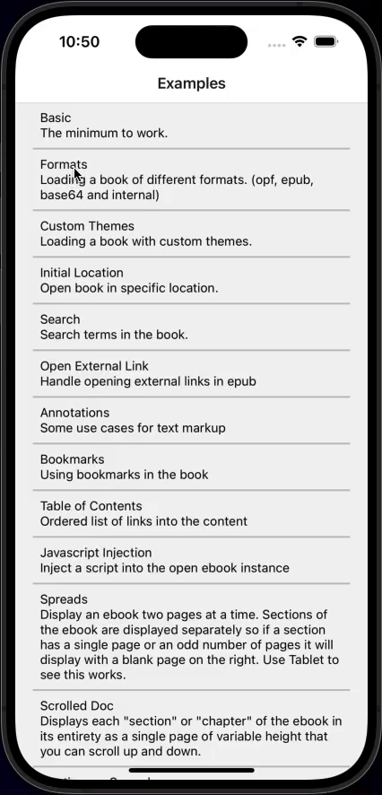

The minimum to work
[View example](../example-expo/examples/Basic/index.tsx)

##### Formats

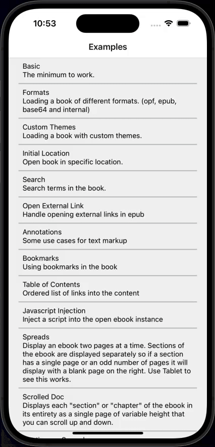

Loading a book of different formats. (opf, epub, base64 and internal)
[View example](../example-expo/examples/Formats/index.tsx)

##### Custom Themes

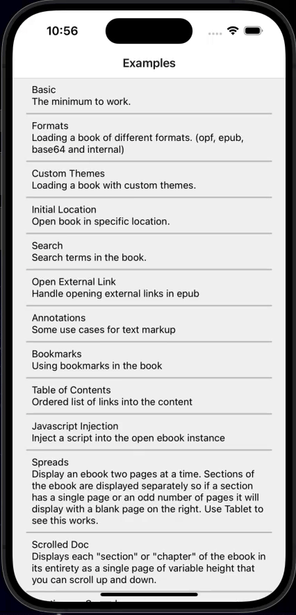

Loading a book with custom themes
[View example](../example-expo/examples/CustomThemes/index.tsx)

##### Initial Location

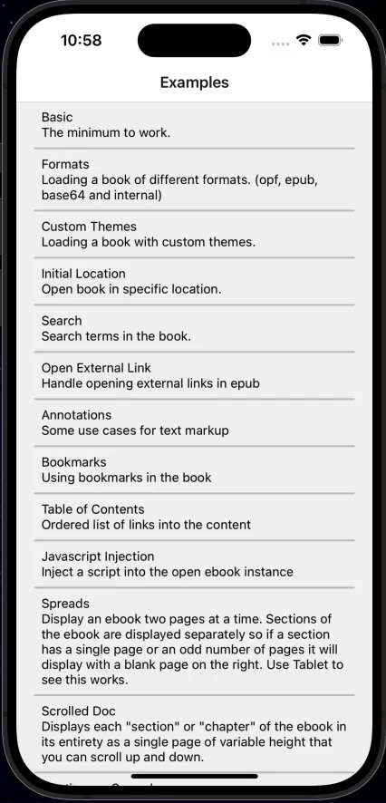

Loading a book with custom themes
[View example](../example-expo/examples/InitialLocation/index.tsx)

##### Search


Search terms in the book
[View example](../example-expo/examples/Search/index.tsx)

##### Open External Link

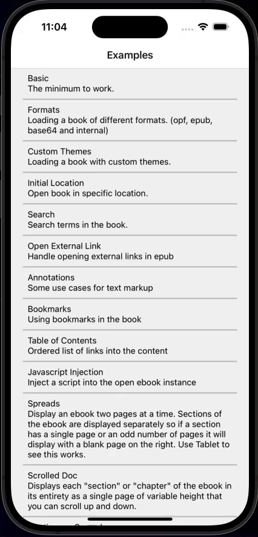

Search terms in the book
[View example](../example-expo/examples/OpenExternalLink/index.tsx)

##### Annotations

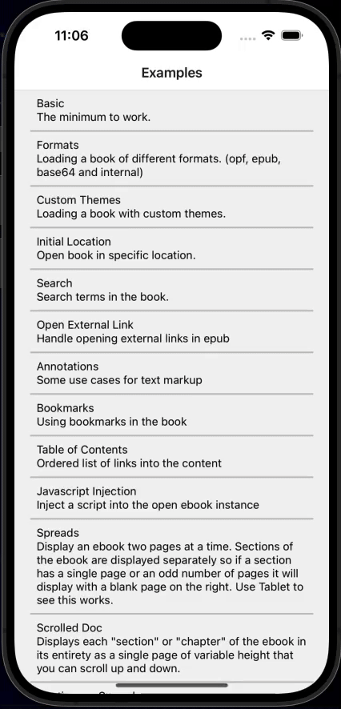

Text markup uses `menuItems` on `<Reader>` and `addAnnotation` from `useReader()`. On iOS the custom items render in a React Native overlay, so the menu shows again after the user adjusts the selection handles or taps the selection. Android keeps the native WebView menu.

This overlay fixes [#352](https://github.com/victorsoares96/epubjs-react-native/issues/352) (same report in [#343](https://github.com/victorsoares96/epubjs-react-native/issues/343)): after iOS 16 the native WebView menu did not reappear when the selection changed.

```tsx
import { Reader, useReader } from '@epubjs-react-native/core';
// import { useFileSystem } from '@epubjs-react-native/file-system'; // Bare React Native
// import { useFileSystem } from '@epubjs-react-native/expo-file-system'; // Expo

function Book() {
  const { addAnnotation } = useReader();

  return (
    <Reader
      src="https://s3.amazonaws.com/moby-dick/OPS/package.opf"
      fileSystem={useFileSystem}
      menuItems={[
        {
          label: 'Highlight',
          action: (cfiRange) => {
            addAnnotation('highlight', cfiRange, undefined, { color: '#23CE6B' });
            return true; // clear the selection after the action
          },
        },
        {
          label: 'Add Note',
          action: (cfiRange, text) => {
            addAnnotation('highlight', cfiRange, { note: text });
            return true;
          },
        },
      ]}
      onAddAnnotation={(annotation) => {
        console.log('added', annotation);
      }}
      onPressAnnotation={(annotation) => {
        console.log('pressed', annotation);
      }}
      onChangeAnnotations={(next) => {
        console.log('annotations', next);
      }}
    />
  );
}
```

Return `false` from `action` if you want to keep the current selection. Load previously saved marks with `initialAnnotations` and read the current list from `annotations` on `useReader()`.

[View example](../example-expo/examples/Annotations/index.tsx)

###### iOS selection menu

| Setup | Custom `menuItems` | System menu (Look Up / Translate / Share) |
| ----- | ------------------ | ----------------------------------------- |
| Android | Native WebView menu | Not applicable |
| iOS in Expo Go | Overlay works | Still visible |
| iOS development / production build **without** the plugin | Overlay works | Still visible |
| iOS development / production build **with** the plugin | Overlay works | Hidden |

Add the plugin only when you use `menuItems` on iOS and want a single custom menu:

```json
{
  "expo": {
    "plugins": ["@epubjs-react-native/core"]
  }
}
```

Rebuild the native app after adding it. Expo Go cannot apply this WebView patch. Reading books without `menuItems` does not need the plugin.

Bare React Native projects do not run Expo config plugins; apply the equivalent `react-native-webview` menu suppression in native iOS and rebuild.

##### Bookmarks

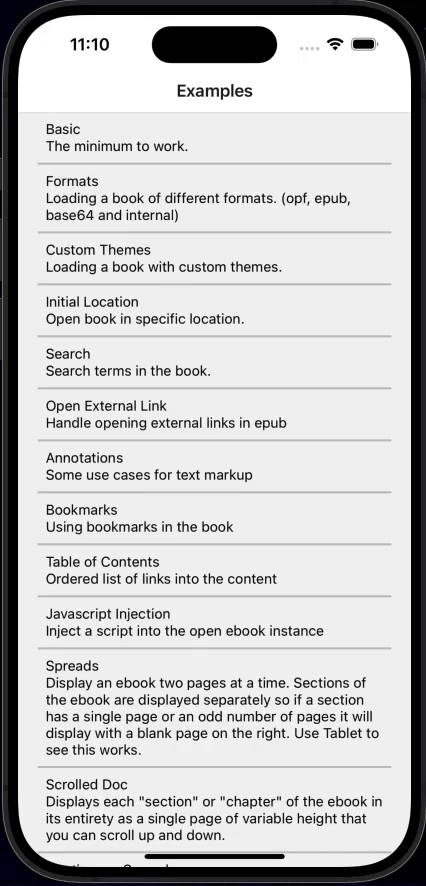

Using bookmarks in the book
[View example](../example-expo/examples/Bookmarks/index.tsx)

##### Table Of Contents

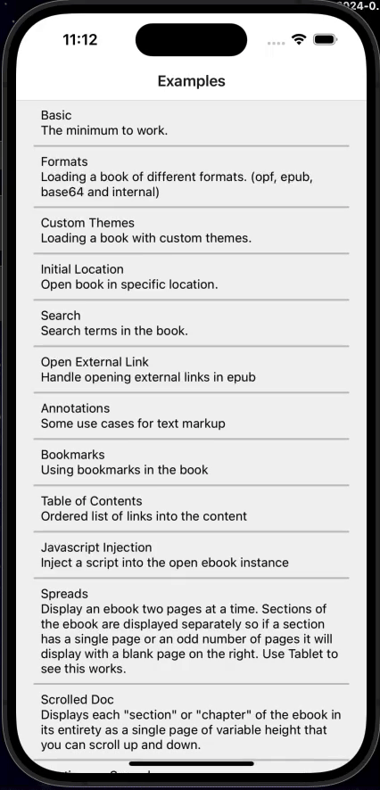

Ordered list of links into the content
[View example](../example-expo/examples/TableOfContents/index.tsx)

##### Javascript Injection

Inject a script into the open ebook instance
[View example](../example-expo/examples/JavascriptInjection/index.tsx)

##### Spreads


Display an ebook two pages at a time. Sections of the ebook are displayed separately so if a section has a single page or an odd number of pages it will display with a blank page on the right. Use Tablet to see this works.
[View example](../example-expo/examples/Spreads/index.tsx)

##### Scrolled Doc


Displays each "section" or "chapter" of the ebook in its entirety as a single page of variable height that you can scroll up and down.
[View example](../example-expo/examples/ScrolledDoc/index.tsx)

##### Continuous Spreads

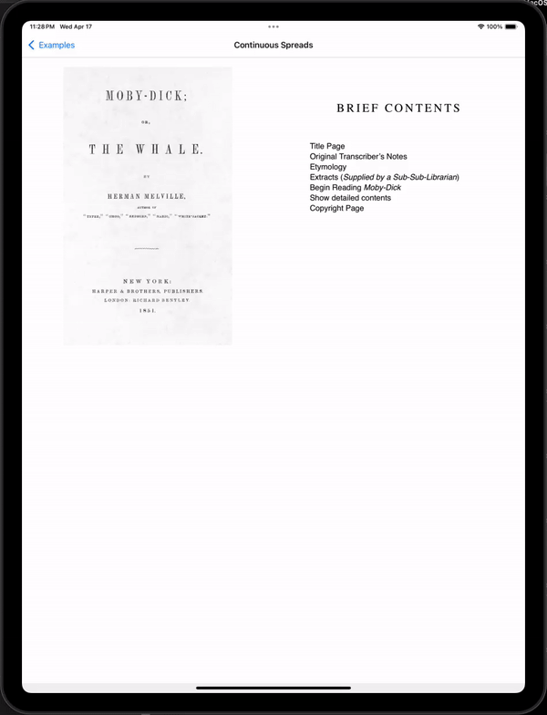

The example is the same as Spreads above except that the entire document is rendered at once without breaks so if a section has one page, the next section is shown beginning on the right-hand-page rather than a blank page.
[View example](../example-expo/examples/ContinuousSpreads/index.tsx)

##### With Slider

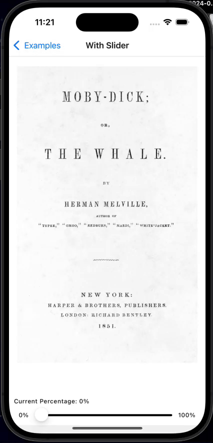

Navigate between locations with slider
[View example](../example-expo/examples/WithSlider/index.tsx)

##### Full Example

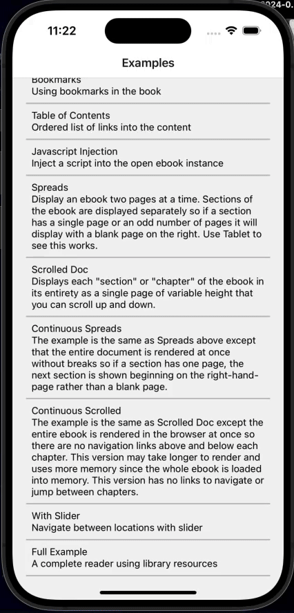

A complete reader using library resources
[View example](../example-expo/examples/FullExample/index.tsx)
